# Architecture

_Last updated: Go step 2 (in-memory store). The Vue phases (0–9) are complete; the Go backend in `server/` is being built step by step._

This file shows the project as it currently stands. It is updated at the end of every phase and only diagrams what exists. The frontend sections come first; the **Go backend** section is near the end.

## App bootstrap

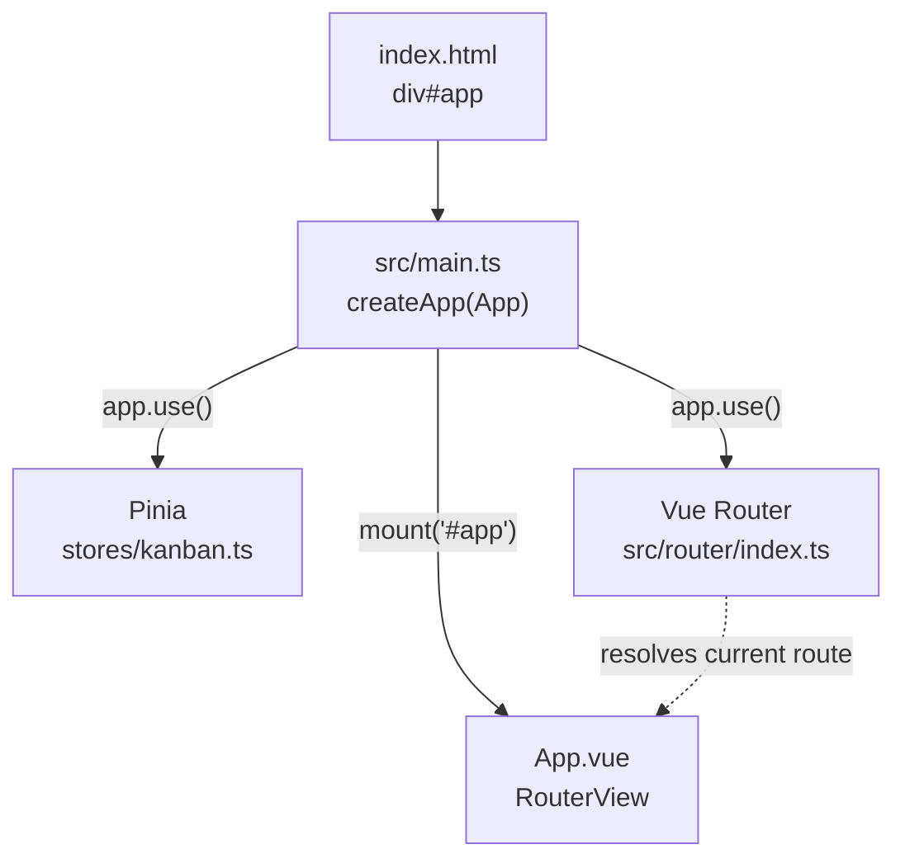

## Component tree

Solid arrows are parent → child, labelled with what is passed down (props, `v-model`) and what comes back up (events). Dotted arrows are store or router access. The views, `BoardView`, `BoardToolbar`, `CardEditor` and `CardMoveMenu` talk to the store; the rest are driven by props, models and events.

```mermaid
flowchart TD
  app["App.vue<br/>RouterView<br/>provideTheme()"]
  store[("stores/kanban.ts<br/>useKanbanStore")]

  app -- "route /" --> list["views/BoardsListView.vue<br/>create, rename, delete boards"]
  app -- "route /boards/:boardId<br/>prop boardId" --> detail["views/BoardDetailView.vue<br/>nested RouterView (keyed by path)"]

  list -. "boardList, addBoard, deleteBoard,<br/>v-model writes board.title" .-> store
  list --> toggleList["ThemeToggle.vue"]
  list --> toolbar["components/BoardToolbar.vue<br/>Export JSON, Import JSON, Reset"]
  list -- "v-model (board title)" --> inlineList["InlineEdit.vue"]
  list -- "emits add(title)" --> addBoard["AddItemForm.vue"]
  toolbar -. "reads state, importState, resetToDemo" .-> store

  detail -- "prop board" --> board["components/BoardView.vue"]
  detail -- "child route cards/:cardId<br/>props boardId, cardId" --> editor["components/CardEditor.vue<br/>draft form: title, description, labels, due date"]
  detail -. "reads state.boards[boardId]" .-> store

  board -. "getters, actions,<br/>v-model writes column.title" .-> store
  board -- ":title + @update:title<br/>(→ renameBoard)" --> header["components/BoardHeader.vue<br/>back link, title via InlineEdit"]
  header --> toggle["components/ThemeToggle.vue<br/>useTheme() via inject"]
  app -. "provide(themeKey)" .-> toggle
  board -- "prop labels" --> filterBar["components/FilterBar.vue<br/>search input, label toggles, clear"]
  filters[["composables/useBoardFilters.ts<br/>derived from route.query"]]
  board -. "isFiltering, matches" .-> filters
  filterBar -. "reads filters;<br/>setSearchText (debounced), toggleLabel, clearFilters" .-> filters
  board -- "v-model:title,<br/>props cardCount, totalCount, emptyText" --> column["components/KanbanColumn.vue<br/>slots: #actions, default, #footer<br/>TransitionGroup around the default slot"]
  board -- "prop card, emits delete<br/>(into column's default slot)" --> card["components/KanbanCard.vue<br/>title is a RouterLink to the card route<br/>default slot for extra controls"]
  board -- "props card, column, boardId, canReorder<br/>(into the card's default slot)" --> move["components/CardMoveMenu.vue<br/>details/summary: columns, Up, Down"]
  move -. "columnsForBoard, moveCard" .-> store
  board -- ":open + @update:open (card forms only)<br/>emits add(title)<br/>(column #footer, and 'Add column')" --> add["AddItemForm.vue<br/>v-model:open, v-focus directive"]
  column -- "v-model (title)" --> inlineCol["InlineEdit.vue<br/>defineModel"]

  dnd[["composables/useDragAndDrop.ts"]]
  board -. "calls once in setup" .-> dnd
  dnd -. "onDrop → moveCard" .-> store

  editor -- "v-model:open, prop title<br/>emits closed" --> modal["components/BaseModal.vue<br/>Teleport to body + Transition<br/>closes on Esc, backdrop, ×<br/>useModalFocus()"]
  editor -. "updateCard, deleteCard" .-> store
  editor -. "on closed: router.push(board)" .-> detail
```

## Filtering

The URL query is the only place filter state lives: `?q=text` and `?label=bug&label=ui`. Filtered lists are never copied into state.

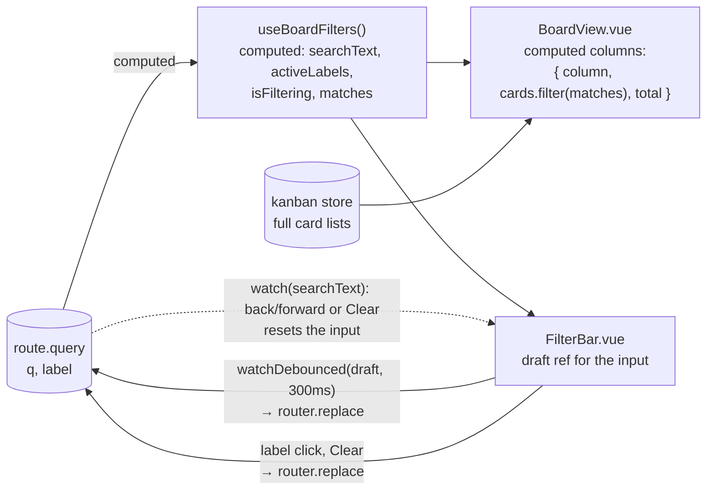

- Text matches title or description (case-insensitive). With several labels active, a card needs any one of them.
- While `isFiltering`, cards render with `draggable="false"` and `FilterBar` explains why.
- A column shows "N of M" and, if nothing matches, "No matching cards".
- `KanbanCard`'s link and `CardEditor`'s close navigation both carry `route.query`, so filters survive opening a card.
- `store.labelsForBoard(boardId)` supplies the label list.

## Theme

`composables/useTheme.ts` holds a typed `InjectionKey<ThemeContext>`. `App.vue` calls `provideTheme()` once; any descendant calls `useTheme()`.

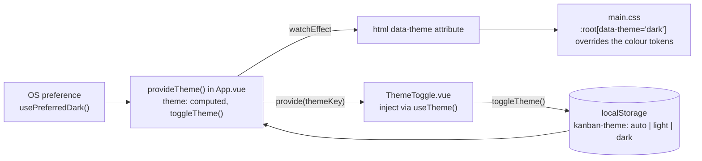

- Components never read the theme to pick colours; they use the CSS variables, which change with the attribute.
- `--color-accent-fill`, `--color-danger-fill` and `--color-on-fill` are for solid buttons, so text on them keeps its contrast in both themes.

## Keyboard and accessibility

`composables/useKeyboardShortcuts.ts` wraps VueUse's `onKeyStroke`. Each component registers the shortcut it owns, and the listener is removed when that component unmounts.

| Key | Registered in | Effect |
|---|---|---|
| `n` | `BoardView` | Opens the add-card form in the first column (sets `addingToColumnId`) |
| `/` | `FilterBar` | Focuses the search input |
| `Esc` | `BaseModal` | Closes the modal |

- Except for `Esc`, shortcuts are ignored while typing in a field, with Ctrl/Cmd/Alt held, or while a modal is open.
- `composables/useModalFocus.ts` moves focus into the dialog on mount (to the `data-autofocus` field), wraps Tab at both ends, and returns focus to the opener on unmount.
- `CardMoveMenu` is the keyboard alternative to drag and drop. After a move it focuses the card's menu in its new place. Up and Down are disabled while filters are active.
- `InlineEdit` and `AddItemForm` return focus to their button after Enter or Esc.
- `main.css` sets one `:focus-visible` outline for every focusable element.

## Drag and drop

`composables/useDragAndDrop.ts` wraps the native HTML5 drag events. `BoardView` calls it once, passing `store.moveCard` as `onDrop`, and binds the handlers in its template. The listeners and attributes are not declared as props or emits, so they fall through to the root elements of `KanbanCard` and `KanbanColumn`.

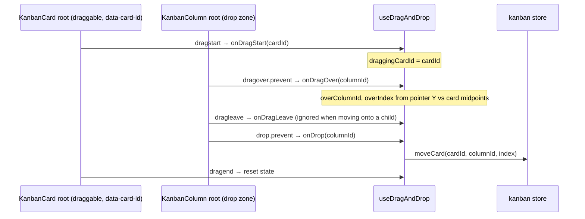

- Reactive state: `draggingCardId`, `overColumnId`, `overIndex` (counted among the column's cards without the dragged one, which is the final index `moveCard` expects).
- `dropPosition(columnId, cardIds, cardId)` returns `'before' | 'after' | null`; `BoardView` binds it to `data-drop` on each card.
- Visual state is global CSS in `src/assets/main.css`: `.is-dragging`, `.is-drop-target`, and the `[data-drop]` indicator line. The shared `.button` and `.icon-button` classes live there too.

## Transitions

`KanbanColumn` wraps its default slot in `<TransitionGroup tag="div" name="card-list">`, so every keyed card passed in by `BoardView` animates without either the card or the board knowing about it.

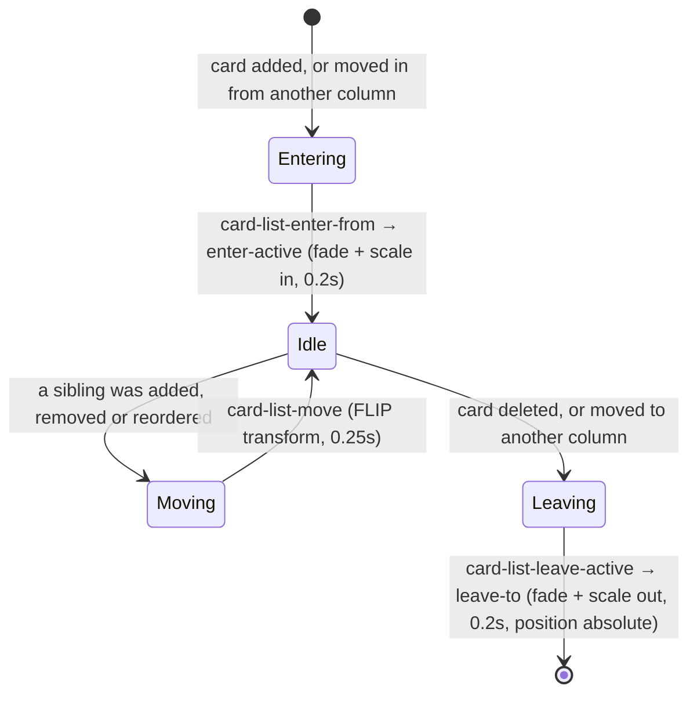

- The "No cards yet" message is a keyed child of the same group, so it fades in and out too.
- A move between columns is a leave in one group and an enter in the other, not a single slide.
- The styles live in `KanbanColumn.vue` and use `:deep()` because slotted cards don't carry the column's scope id.
- `prefers-reduced-motion: reduce` sets all three transitions to `none`.
- Columns grow to their content and clip it (`overflow: hidden`); `.board__columns` in `BoardView` scrolls in both directions.

## Store

`stores/kanban.ts` is a Pinia setup store. State is one deep ref of `KanbanState` created by VueUse's `useStorage`, so it is backed by `localStorage` (see Persistence below).

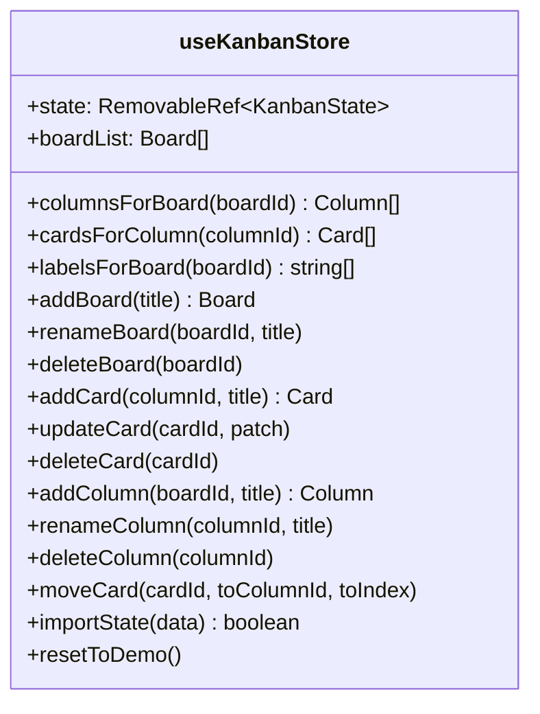

- `boardList`, `columnsForBoard`, `cardsForColumn` and `labelsForBoard` are `computed` getters; the last three return lookup functions.
- `deleteColumn` also deletes the column's cards; `deleteBoard` deletes its columns the same way.
- `moveCard` places the card at `toIndex` in the target column (clamped). It is called by the drag-and-drop composable.
- `importState` replaces the whole state only if `isKanbanState(data)` passes, and returns whether it did.
- Unit tests: `src/stores/__tests__/kanban.spec.ts` (`addCard`, `moveCard`, `deleteColumn`, `deleteBoard`, persistence, `importState`, `resetToDemo`).

## Persistence

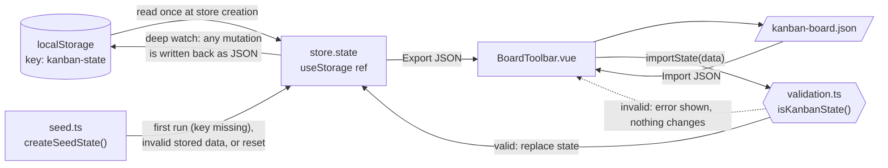

- `src/validation.ts` checks the shape of every entity, that each is stored under its own id, and that every referenced column and card exists and is placed only once. Tests: `src/__tests__/validation.spec.ts`.
- Reset asks for confirmation inline in the toolbar before calling `resetToDemo()`.
- `vitest.config.ts` passes `--no-experimental-webstorage` so Node's own `localStorage` global doesn't hide jsdom's in tests.

## Data model

Defined in `src/types.ts`. State is normalised: entities live in records keyed by ID, and order lives in the ID arrays.

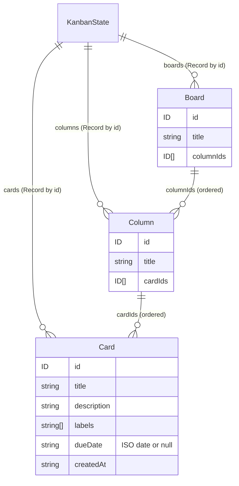

`CardPatch` is the editable subset of a card (`title`, `description`, `labels`, `dueDate`), used by `updateCard`, which `CardEditor` calls on Save.

`src/seed.ts` exports `createSeedState()`, which builds one board with three columns (To do / Doing / Done) and six cards, with fresh IDs on each call.

## Routes

Defined in `src/router/index.ts` (history mode, no file-based routing).

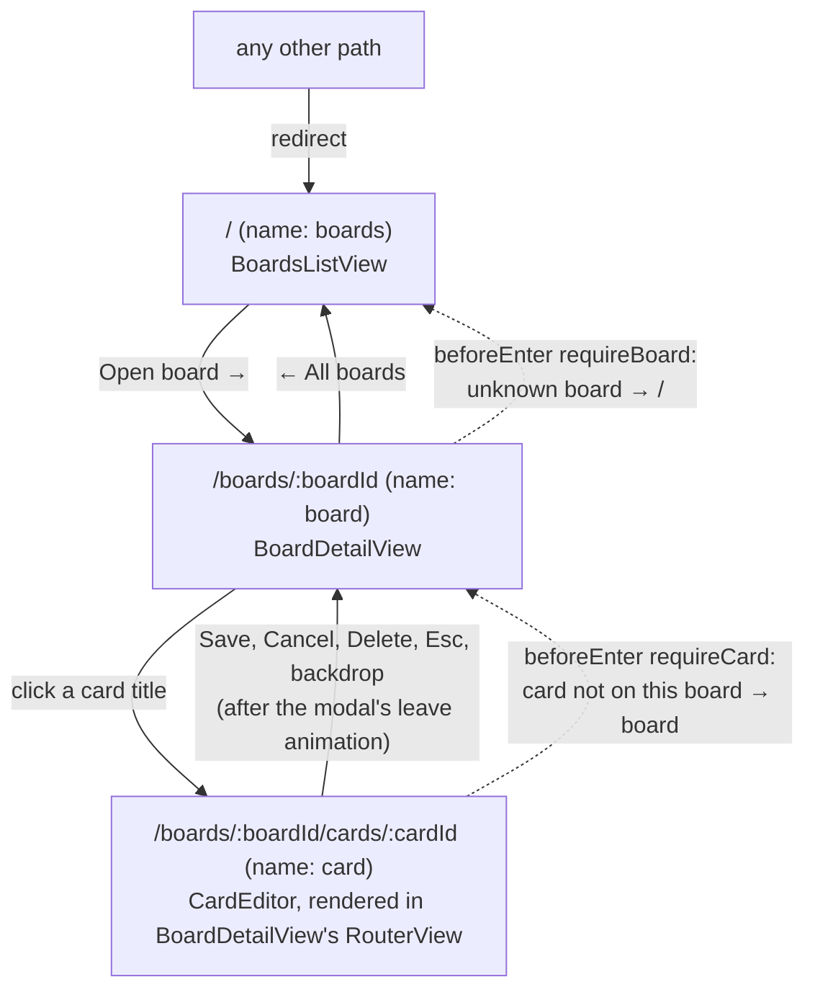

- Params reach components as props (`props` on the route), so `BoardDetailView` and `CardEditor` don't read `route.params`.
- `beforeEnter` only runs when the route is entered, so `BoardDetailView` also renders a "no longer exists" message if its board disappears later.
- `KanbanCard` links to `{ name: 'card', params: { cardId } }`; the router reuses `boardId` from the current location.

## Tests

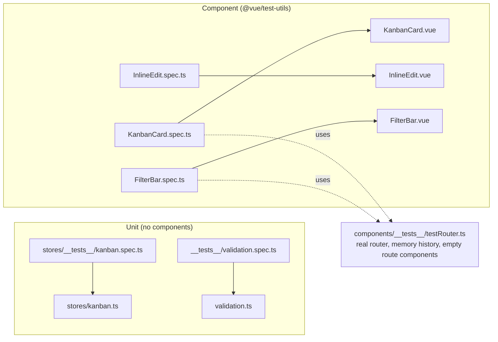

- Component tests mount one component with `global.plugins: [router]`, so `RouterLink`, `useRoute` and `useRouter` behave as in the app.
- `FilterBar.spec.ts` uses Vitest fake timers to skip the 300ms debounce.
- Run once with `npx vitest run`; `npm run test:unit` watches.

## Go backend

Lives in `server/` (its own Go module). See `server/CLAUDE.md` for the plan and `server/LEARNING.md` for the Go concepts, step by step.

### Package layout

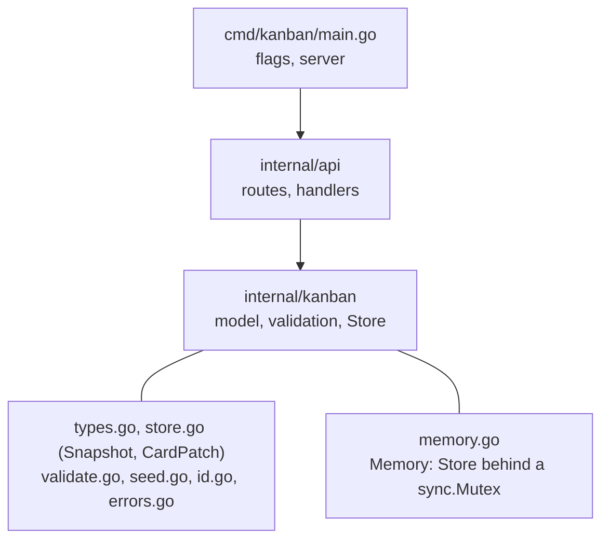

`internal/` means nothing outside `server/` can import these packages.

### Store

`Store` is the interface the HTTP layer will use. Every write returns the new `version`; unknown IDs return `ErrNotFound`, bad input `ErrInvalid`, a stale `ReplaceState` `ErrConflict`.

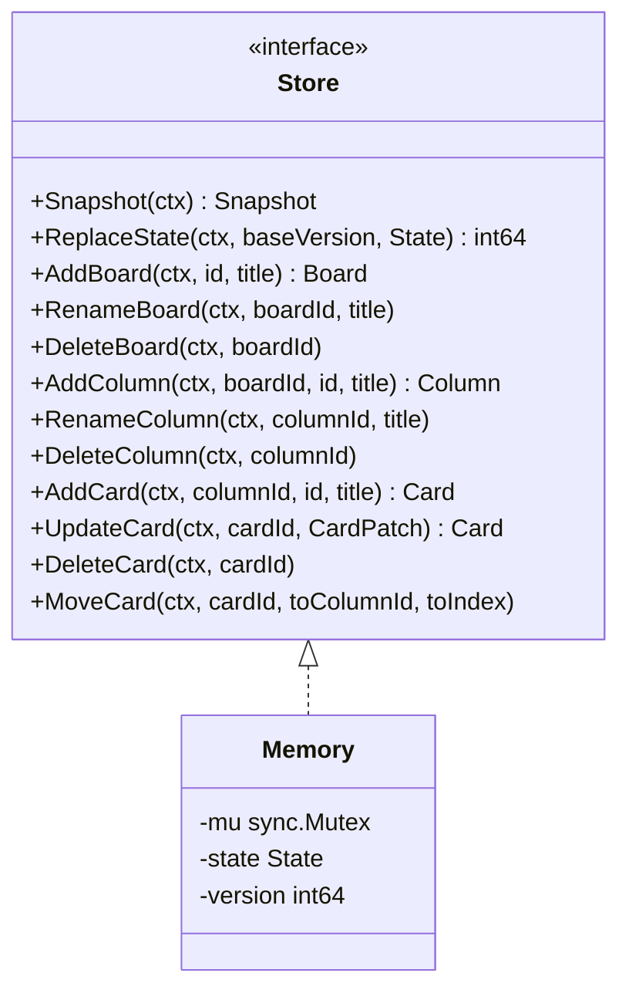

- The Go types (`Board`, `Column`, `Card`, `State`) mirror `src/types.ts`; `State` also carries `BoardOrder` so the order of boards survives JSON (a Go map has no order).
- `Validate` ports `src/validation.ts` and adds: every column must be listed by a board and every card by a column.
- `testStore` (`internal/kanban/store_suite_test.go`) is the one behaviour test suite every `Store` implementation runs.

## Not built yet

Nothing from the Vue plan. Optional stretch goals in `CLAUDE.md` (only if asked): a Nuxt port, touch drag and drop, undo/redo.

Go backend, still to come: HTTP API (step 3), the Vue app calling it (step 4), SQLite (5), per-action endpoints (6), live updates (7), embedded frontend (8).
