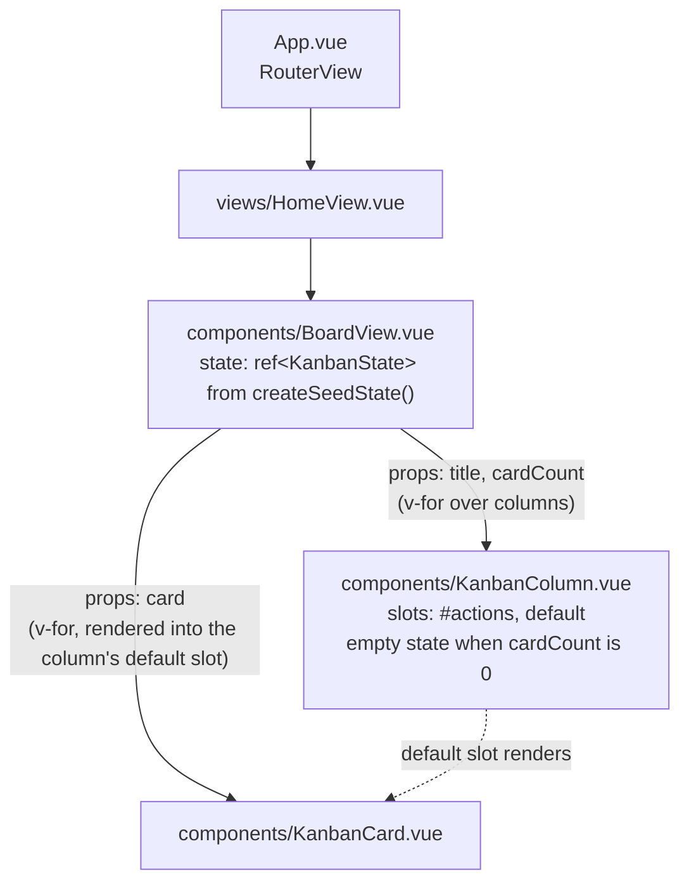
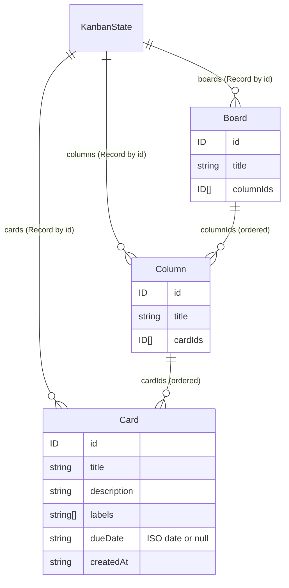
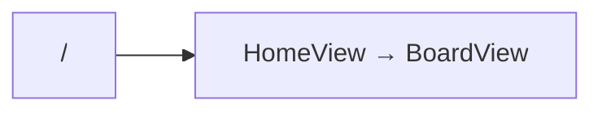

# Architecture

_Last updated: phase 1 (static board with components and props)._

This file shows the project as it currently stands. It is updated at the end of every phase and only diagrams what exists.

## App bootstrap

## Component tree

Solid arrows are parent → child, labelled with the props passed down. Nothing emits events yet; the board is read-only.

## Data model

Defined in `src/types.ts`. State is normalised: entities live in records keyed by ID, and order lives in the ID arrays.

`src/seed.ts` exports `createSeedState()`, which builds one board with three columns (To do / Doing / Done) and six cards, with fresh IDs on each call.

## Routes

## Not built yet

- Pinia store, editing, and events from child components: phase 2
- Drag and drop: phase 3
