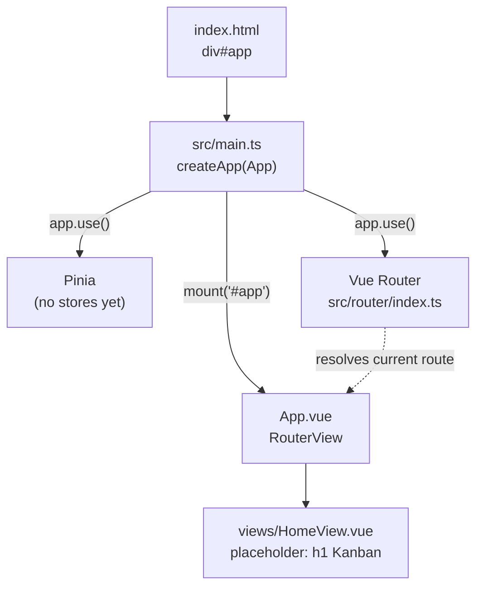
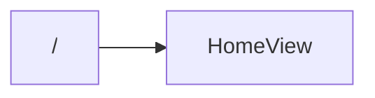

# Architecture

_Last updated: phase 0 (scaffold)._

This file shows the project as it currently stands. It is updated at the end of every phase and only diagrams what exists.

## App bootstrap and component tree

## Routes

## Not built yet

- Data model (`src/types.ts`) and seed data: phase 1
- Board components: phase 1
- Pinia store: phase 2
