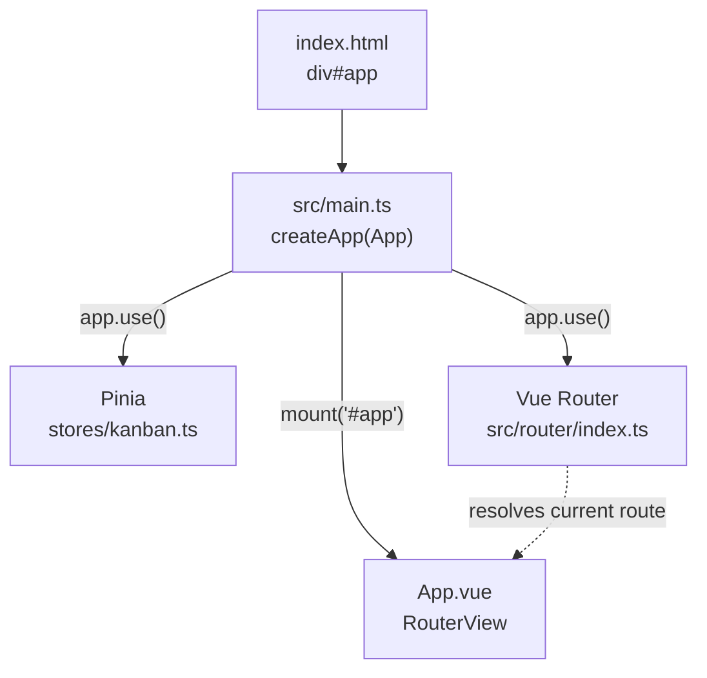
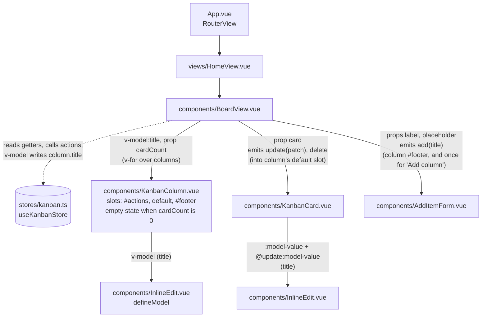
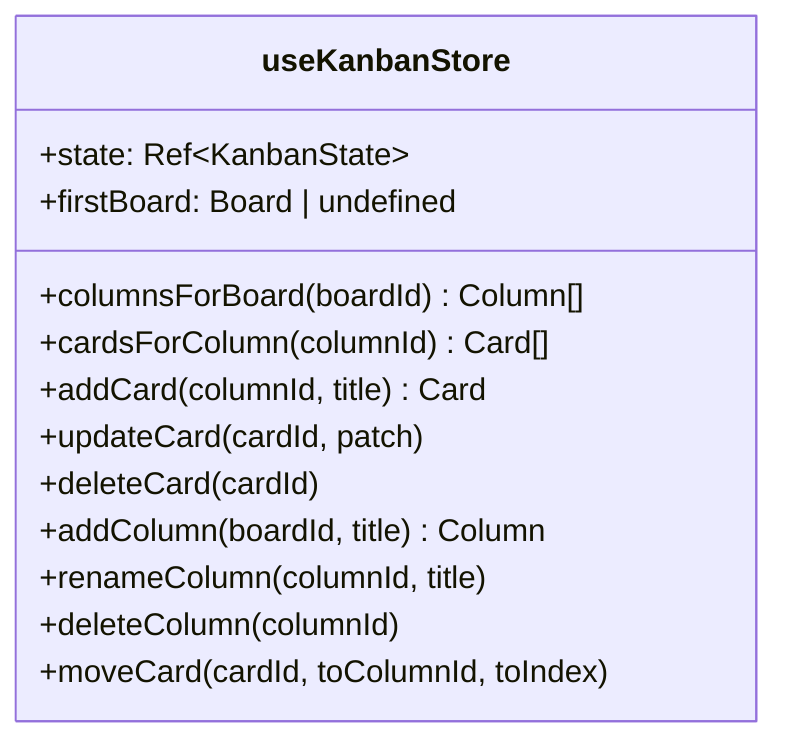
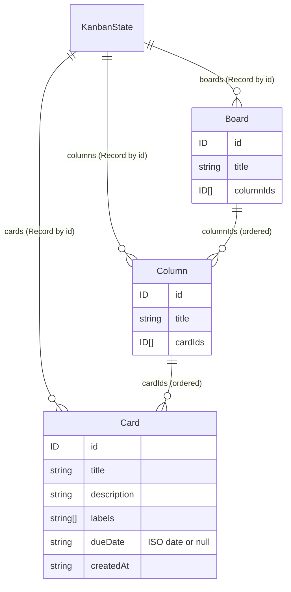
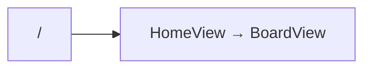

# Architecture

_Last updated: phase 2 (Pinia store and editing)._

This file shows the project as it currently stands. It is updated at the end of every phase and only diagrams what exists.

## App bootstrap

## Component tree

Solid arrows are parent → child, labelled with what is passed down (props, `v-model`) and what comes back up (events). Dotted arrows are store access. Only `BoardView` talks to the store; every other component is driven by props, models and events.

## Store

`stores/kanban.ts` is a Pinia setup store. State is one deep `ref<KanbanState>`, initialised from `createSeedState()` (not persisted yet, so a refresh resets it).

- `firstBoard`, `columnsForBoard` and `cardsForColumn` are `computed` getters; the last two return lookup functions.
- `deleteColumn` also deletes the column's cards.
- `moveCard` places the card at `toIndex` in the target column (clamped). No UI calls it yet; drag and drop arrives in phase 3.
- Unit tests: `src/stores/__tests__/kanban.spec.ts` (`addCard`, `moveCard`, `deleteColumn`).

## Data model

Defined in `src/types.ts`. State is normalised: entities live in records keyed by ID, and order lives in the ID arrays.

`CardPatch` is the editable subset of a card (`title`, `description`, `labels`, `dueDate`), used by `updateCard` and `KanbanCard`'s `update` event.

`src/seed.ts` exports `createSeedState()`, which builds one board with three columns (To do / Doing / Done) and six cards, with fresh IDs on each call.

## Routes

## Not built yet

- Drag and drop (the UI for `moveCard`): phase 3
- Persistence: phase 5
