# Architecture

_Last updated: Go step 8 (one binary). The Vue phases (0–9) are complete; the Go backend in `server/` is being built step by step._

This file shows the project as it currently stands. It is updated at the end of every phase and only diagrams what exists. The frontend sections come first; the **Go backend** section is near the end.

## App bootstrap

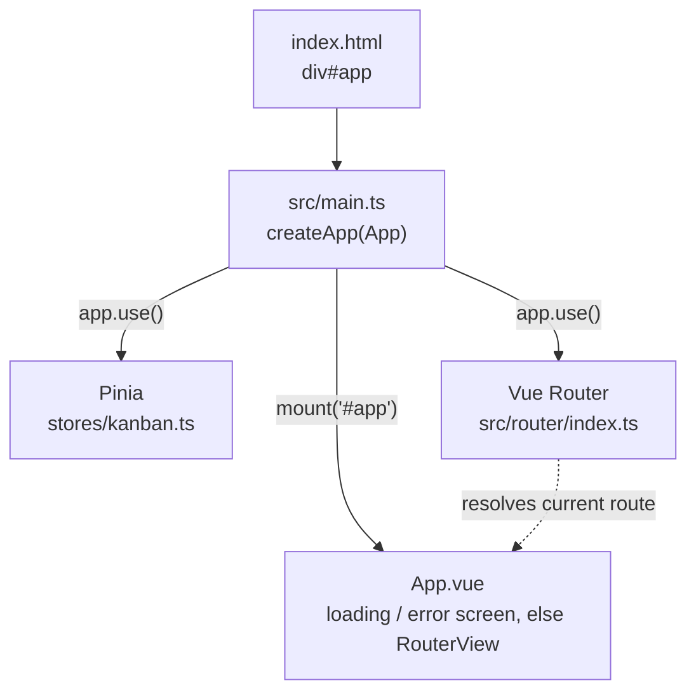

## Component tree

Solid arrows are parent → child, labelled with what is passed down (props, `v-model`) and what comes back up (events). Dotted arrows are store or router access. The views, `BoardView`, `BoardToolbar`, `CardEditor` and `CardMoveMenu` talk to the store; the rest are driven by props, models and events.

```mermaid
flowchart TD
  app["App.vue<br/>RouterView (once the store is ready)<br/>SyncNotice<br/>provideTheme()"]
  store[("stores/kanban.ts<br/>useKanbanStore")]

  app -- "route /" --> list["views/BoardsListView.vue<br/>create, rename, delete boards"]
  app -- "route /boards/:boardId<br/>prop boardId" --> detail["views/BoardDetailView.vue<br/>nested RouterView (keyed by path)"]

  list -. "boardList, addBoard, deleteBoard,<br/>v-model writes board.title" .-> store
  list --> toggleList["ThemeToggle.vue"]
  list --> toolbar["components/BoardToolbar.vue<br/>Export JSON, Import JSON, Reset"]
  list -- "v-model (board title)" --> inlineList["InlineEdit.vue"]
  list -- "emits add(title)" --> addBoard["AddItemForm.vue"]
  toolbar -. "reads state, importState, resetToDemo" .-> store

  detail -- "prop board" --> board["components/BoardView.vue"]
  detail -- "child route cards/:cardId<br/>props boardId, cardId" --> editor["components/CardEditor.vue<br/>draft form: title, description, labels, due date"]
  detail -. "reads state.boards[boardId]" .-> store

  board -. "getters, actions,<br/>v-model writes column.title" .-> store
  board -- ":title + @update:title<br/>(→ renameBoard)" --> header["components/BoardHeader.vue<br/>back link, title via InlineEdit"]
  header --> toggle["components/ThemeToggle.vue<br/>useTheme() via inject"]
  app -. "provide(themeKey)" .-> toggle
  board -- "prop labels" --> filterBar["components/FilterBar.vue<br/>search input, label toggles, clear"]
  filters[["composables/useBoardFilters.ts<br/>derived from route.query"]]
  board -. "isFiltering, matches" .-> filters
  filterBar -. "reads filters;<br/>setSearchText (debounced), toggleLabel, clearFilters" .-> filters
  board -- "v-model:title,<br/>props cardCount, totalCount, emptyText" --> column["components/KanbanColumn.vue<br/>slots: #actions, default, #footer<br/>TransitionGroup around the default slot"]
  board -- "prop card, emits delete<br/>(into column's default slot)" --> card["components/KanbanCard.vue<br/>title is a RouterLink to the card route<br/>default slot for extra controls"]
  board -- "props card, column, boardId, canReorder<br/>(into the card's default slot)" --> move["components/CardMoveMenu.vue<br/>details/summary: columns, Up, Down"]
  move -. "columnsForBoard, moveCard" .-> store
  board -- ":open + @update:open (card forms only)<br/>emits add(title)<br/>(column #footer, and 'Add column')" --> add["AddItemForm.vue<br/>v-model:open, v-focus directive"]
  column -- "v-model (title)" --> inlineCol["InlineEdit.vue<br/>defineModel"]

  dnd[["composables/useDragAndDrop.ts"]]
  board -. "calls once in setup" .-> dnd
  dnd -. "onDrop → moveCard" .-> store

  editor -- "v-model:open, prop title<br/>emits closed" --> modal["components/BaseModal.vue<br/>Teleport to body + Transition<br/>closes on Esc, backdrop, ×<br/>useModalFocus()"]
  editor -. "updateCard, deleteCard" .-> store
  editor -. "on closed: router.push(board)" .-> detail
```

## Filtering

The URL query is the only place filter state lives: `?q=text` and `?label=bug&label=ui`. Filtered lists are never copied into state.

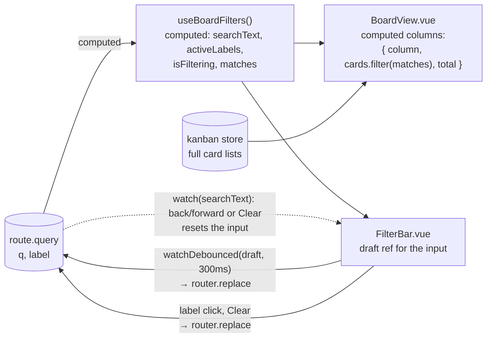

- Text matches title or description (case-insensitive). With several labels active, a card needs any one of them.
- While `isFiltering`, cards render with `draggable="false"` and `FilterBar` explains why.
- A column shows "N of M" and, if nothing matches, "No matching cards".
- `KanbanCard`'s link and `CardEditor`'s close navigation both carry `route.query`, so filters survive opening a card.
- `store.labelsForBoard(boardId)` supplies the label list.

## Theme

`composables/useTheme.ts` holds a typed `InjectionKey<ThemeContext>`. `App.vue` calls `provideTheme()` once; any descendant calls `useTheme()`.

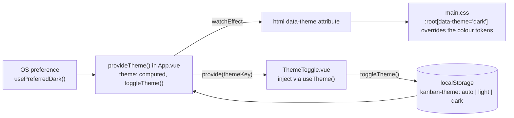

- Components never read the theme to pick colours; they use the CSS variables, which change with the attribute.
- `--color-accent-fill`, `--color-danger-fill` and `--color-on-fill` are for solid buttons, so text on them keeps its contrast in both themes.

## Keyboard and accessibility

`composables/useKeyboardShortcuts.ts` wraps VueUse's `onKeyStroke`. Each component registers the shortcut it owns, and the listener is removed when that component unmounts.

| Key | Registered in | Effect |
|---|---|---|
| `n` | `BoardView` | Opens the add-card form in the first column (sets `addingToColumnId`) |
| `/` | `FilterBar` | Focuses the search input |
| `Esc` | `BaseModal` | Closes the modal |

- Except for `Esc`, shortcuts are ignored while typing in a field, with Ctrl/Cmd/Alt held, or while a modal is open.
- `composables/useModalFocus.ts` moves focus into the dialog on mount (to the `data-autofocus` field), wraps Tab at both ends, and returns focus to the opener on unmount.
- `CardMoveMenu` is the keyboard alternative to drag and drop. After a move it focuses the card's menu in its new place. Up and Down are disabled while filters are active.
- `InlineEdit` and `AddItemForm` return focus to their button after Enter or Esc.
- `main.css` sets one `:focus-visible` outline for every focusable element.

## Drag and drop

`composables/useDragAndDrop.ts` wraps the native HTML5 drag events. `BoardView` calls it once, passing `store.moveCard` as `onDrop`, and binds the handlers in its template. The listeners and attributes are not declared as props or emits, so they fall through to the root elements of `KanbanCard` and `KanbanColumn`.

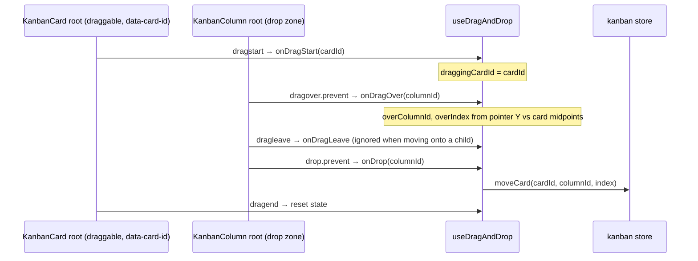

- Reactive state: `draggingCardId`, `overColumnId`, `overIndex` (counted among the column's cards without the dragged one, which is the final index `moveCard` expects).
- `dropPosition(columnId, cardIds, cardId)` returns `'before' | 'after' | null`; `BoardView` binds it to `data-drop` on each card.
- Visual state is global CSS in `src/assets/main.css`: `.is-dragging`, `.is-drop-target`, and the `[data-drop]` indicator line. The shared `.button` and `.icon-button` classes live there too.

## Transitions

`KanbanColumn` wraps its default slot in `<TransitionGroup tag="div" name="card-list">`, so every keyed card passed in by `BoardView` animates without either the card or the board knowing about it.

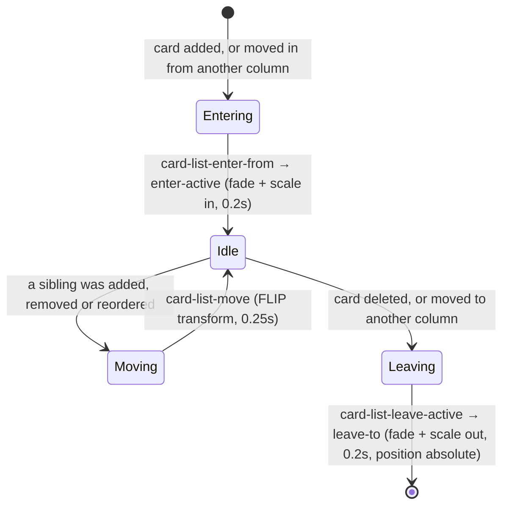

- The "No cards yet" message is a keyed child of the same group, so it fades in and out too.
- A move between columns is a leave in one group and an enter in the other, not a single slide.
- The styles live in `KanbanColumn.vue` and use `:deep()` because slotted cards don't carry the column's scope id.
- `prefers-reduced-motion: reduce` sets all three transitions to `none`.
- Columns grow to their content and clip it (`overflow: hidden`); `.board__columns` in `BoardView` scrolls in both directions.

## Store

`stores/kanban.ts` is a Pinia setup store. State is one deep ref of `KanbanState`, empty until the Go server's copy has been loaded. `composables/useServerSync.ts` (called from inside the store, its refs and functions spread into the store's return value) loads it and sends every action to the server (see Server sync below).

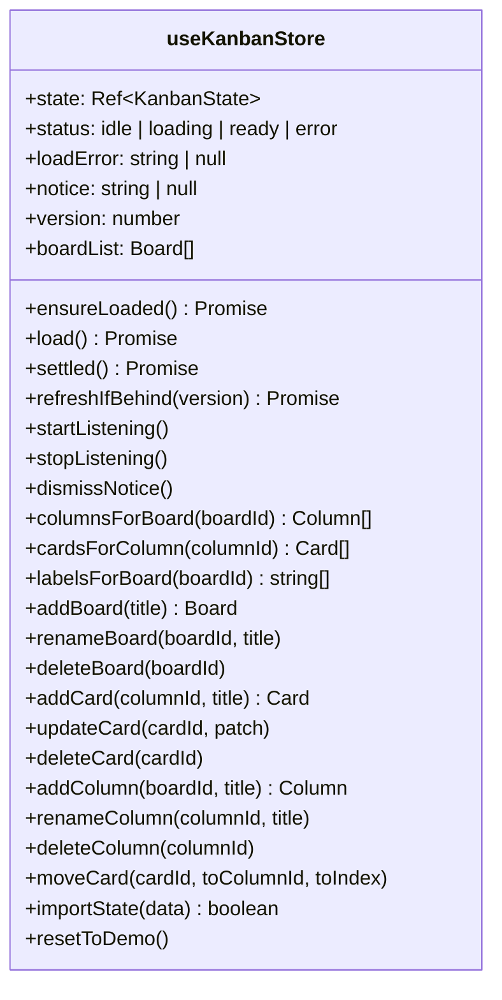

- `boardList`, `columnsForBoard`, `cardsForColumn` and `labelsForBoard` are `computed` getters; the last three return lookup functions.
- `deleteColumn` also deletes the column's cards; `deleteBoard` deletes its columns the same way.
- `moveCard` places the card at `toIndex` in the target column (clamped). It is called by the drag-and-drop composable.
- `importState` replaces the whole state only if `isKanbanState(data)` passes, and returns whether it did.
- Unit tests: `src/stores/__tests__/kanban.spec.ts` (`addCard`, `moveCard`, `deleteColumn`, `deleteBoard`, `importState`, `resetToDemo`) and `src/composables/__tests__/useServerSync.spec.ts` (loading, saving, conflicts). Both run against `src/__tests__/fakeServer.ts`, a stand-in for the Go server's `fetch` endpoints; `src/__tests__/renames.spec.ts` checks that renaming in the UI reaches the server.

## Server sync

The server owns the data (`docs/api.md`). The Vite dev server forwards `/api` to it; `KANBAN_API` (environment or a git-ignored `.env.local`) picks the target, default `http://localhost:8080`.

Reading: the store loads the whole state once (`GET /api/state`) and reloads it when it learns it is behind. Writing: every store action updates `state` first (optimistic) and queues one request.

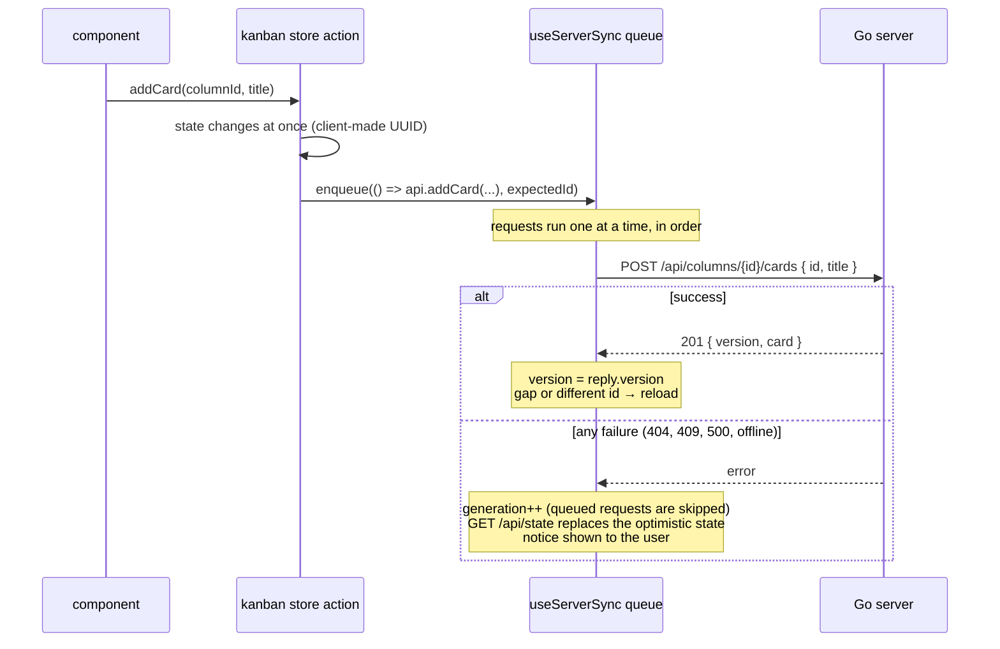

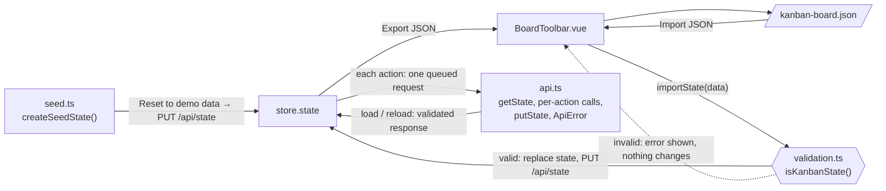

- `composables/useServerSync.ts` holds the queue (`enqueue`, `settled`), the version, `status`, `notice`, and `load`/`ensureLoaded`/`refreshIfBehind`. It is called inside the store and its members are spread into the store's return value.
- `load` waits for the queue to empty and discards a response if a change was queued while it was in flight, so a reload can never wipe out a change the server has not seen.
- Whole-state writes (`importState`, `resetToDemo`) send the version they are based on; a stale one gets 409, which shows the conflict notice and reloads.
- `App.vue` shows "Loading…" until the first load finishes and an error screen (with a reload button) if it failed; `SyncNotice.vue` shows failures.
- Components never write into store entities. `BoardView` and `BoardsListView` rename through `renameColumn` / `renameBoard`; a direct `v-model` on store state would change the screen but never reach the server.
- `src/validation.ts` checks the shape of every entity, that each is stored under its own id, that every referenced column and card exists and is placed only once, and that no column or card is left unplaced (the server's database cannot hold orphans). Tests: `src/__tests__/validation.spec.ts`.
- The theme preference is the only thing still in `localStorage`. `vitest.config.ts` passes `--no-experimental-webstorage` so Node's own `localStorage` global doesn't hide jsdom's in tests.

## Data model

Defined in `src/types.ts`. State is normalised: entities live in records keyed by ID, and order lives in the ID arrays.

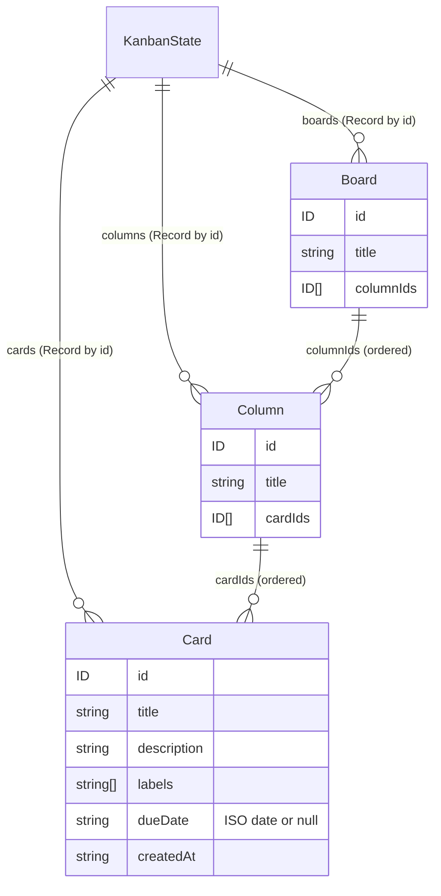

`CardPatch` is the editable subset of a card (`title`, `description`, `labels`, `dueDate`), used by `updateCard`, which `CardEditor` calls on Save.

`src/seed.ts` exports `createSeedState()`, which builds one board with three columns (To do / Doing / Done) and six cards, with fresh IDs on each call.

## Routes

Defined in `src/router/index.ts` (history mode, no file-based routing).

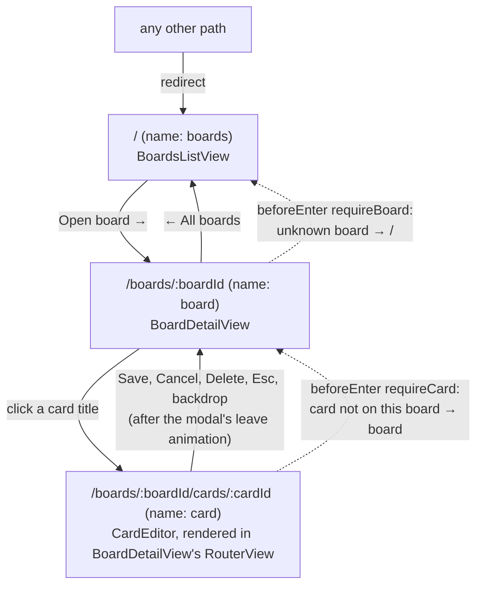

- Params reach components as props (`props` on the route), so `BoardDetailView` and `CardEditor` don't read `route.params`.
- The guards are `async`: they `await store.ensureLoaded()` first, because the data now arrives from the server. If that load failed they let the navigation through, and `App.vue` shows the error instead of the route. Tests: `src/router/__tests__/guards.spec.ts`.
- `beforeEnter` only runs when the route is entered, so `BoardDetailView` also renders a "no longer exists" message if its board disappears later.
- `KanbanCard` links to `{ name: 'card', params: { cardId } }`; the router reuses `boardId` from the current location.

## Tests

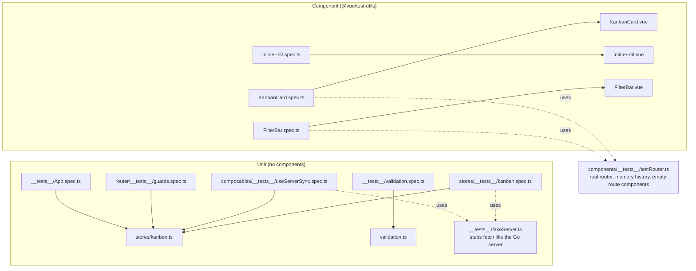

- Component tests mount one component with `global.plugins: [router]`, so `RouterLink`, `useRoute` and `useRouter` behave as in the app.
- `FilterBar.spec.ts` uses Vitest fake timers to skip the 300ms debounce.
- Run once with `npx vitest run`; `npm run test:unit` watches.

## Go backend

Lives in `server/` (its own Go module). See `server/CLAUDE.md` for the plan and `server/LEARNING.md` for the Go concepts, step by step.

### Package layout

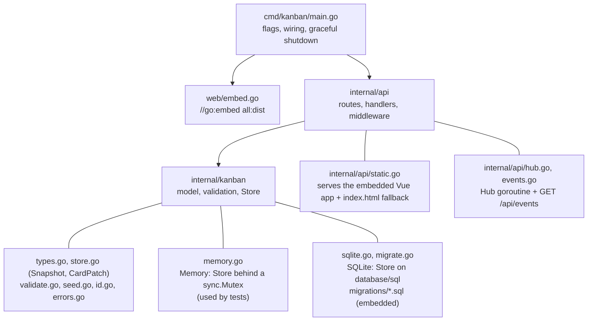

`internal/` means nothing outside `server/` can import these packages.

### Store

`Store` is the interface the HTTP layer will use. Every write returns the new `version`; unknown IDs return `ErrNotFound`, bad input `ErrInvalid`, a stale `ReplaceState` `ErrConflict`.

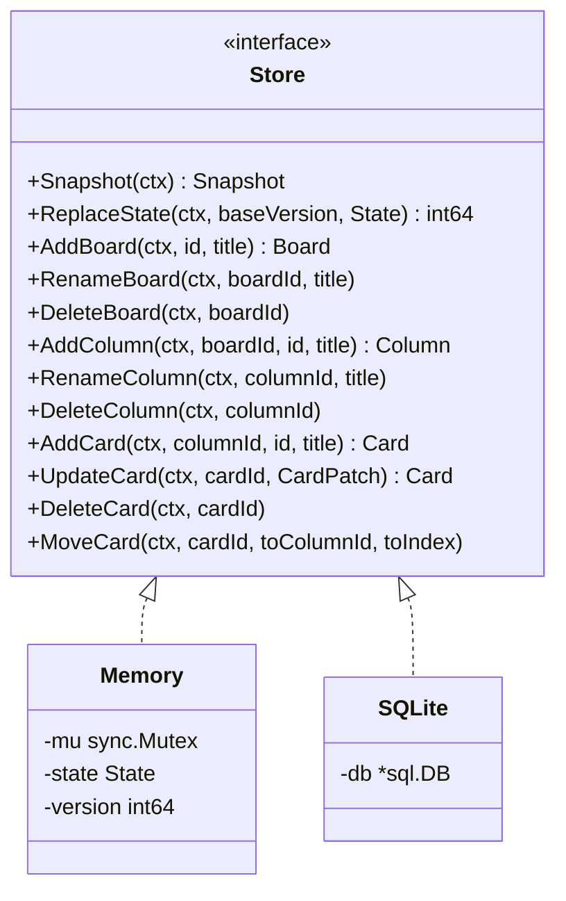

- The Go types (`Board`, `Column`, `Card`, `State`) mirror `src/types.ts`; `State` also carries `BoardOrder` so the order of boards survives JSON (a Go map has no order).
- `Validate` ports `src/validation.ts` and adds: every column must be listed by a board and every card by a column.
- `testStore` (`internal/kanban/store_suite_test.go`) is the one behaviour test suite every `Store` implementation runs: `Memory` and `SQLite` both pass it.

### Database schema

SQLite, created by `internal/kanban/migrations/001_init.sql`, which `migrate` applies at startup (applied files are recorded in `schema_migrations`). Order is an integer `position` within the parent; foreign keys cascade, so deleting a board removes its columns and their cards.

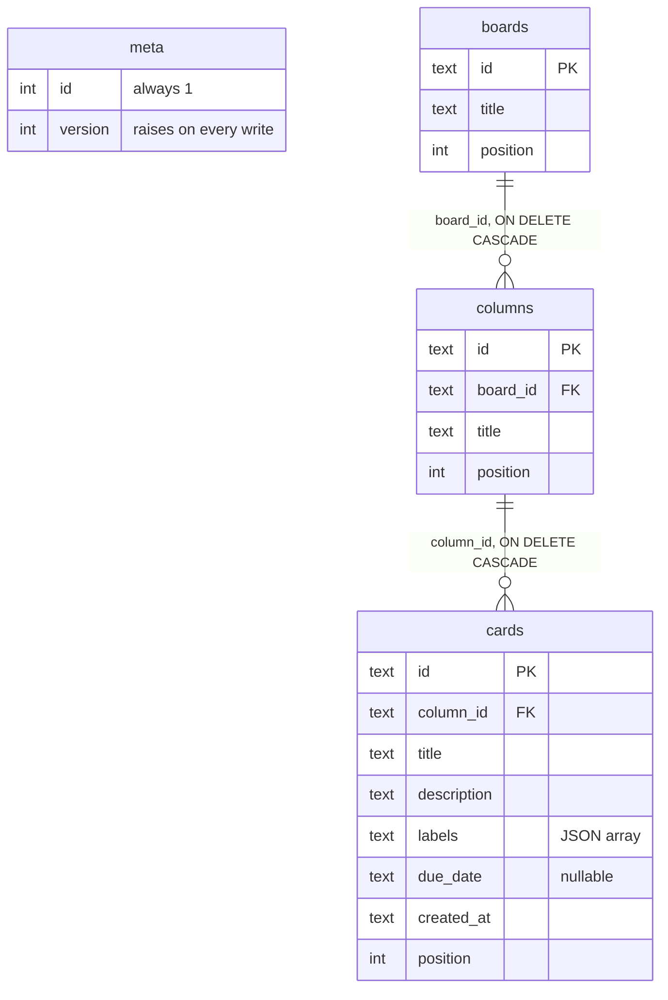

- Every write runs in one transaction (`SQLite.transact`) that also bumps `meta.version`. Moving a card is one transaction of three updates.
- The connection pool is limited to one connection; `foreign_keys`, `busy_timeout` and WAL are set in the DSN.

### Request flow

The contract (methods, paths, bodies, status codes) is in [`api.md`](api.md).

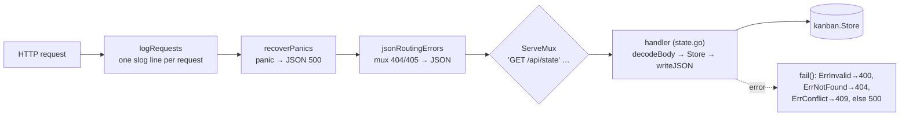

- `GET /api/state` returns `{ version, state }`; `PUT /api/state` takes the same shape, validates it, checks the version (stale → 409) and saves it.
- `resources.go` registers the ten per-action routes (`POST /api/boards`, `PATCH /api/columns/{columnId}`, `PUT /api/cards/{cardId}/position`, …). `rename` and `remove` are functions that return handlers, so boards, columns and cards share the code. Each write returns the new version.
- `decodeBody` caps the body size, rejects unknown fields and trailing data.
- `main.go` opens `kanban.OpenSQLite(ctx, *dbPath)` (flag `-db`, default `kanban.db`), seeds it on first run with `EnsureSeeded`, and passes it to `api.New(store, log).Handler()`.

### Live updates

`Hub` (`internal/api/hub.go`) is one goroutine that owns the set of subscribers; other goroutines talk to it only through channels. Every successful write handler calls `s.wrote(version)`, which publishes the version to the hub.

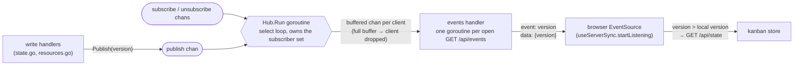

- A new connection first receives the current version, so a reconnecting tab catches up.
- A request's context being cancelled (client closed the tab) ends the handler and unsubscribes it.
- `App.vue` starts listening on mount and stops on unmount. A tab's own writes echo back as events but are ignored, because the reply to the write already moved its version forward.

### One binary

`npm run build:embed` builds the Vue app into `server/web/dist`; `//go:embed` puts those files inside the Go executable, which then serves both the API and the app.

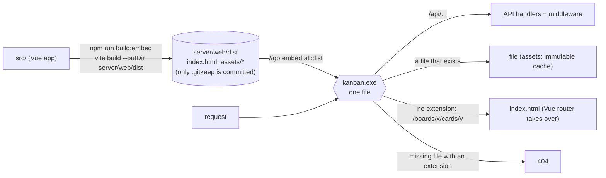

- `main.go` opens the listener, then `run(ctx, log, ln, dbPath, frontend)` serves until the context (cancelled by Ctrl+C or SIGTERM) ends, then calls `http.Server.Shutdown`. `RegisterOnShutdown(app.Close)` ends open event streams so shutdown is not held up.
- Flags: `-addr` (default `:8080`) and `-db` (default `kanban.db`).
- In development nothing changes: Vite serves the app on 5173 and proxies `/api` to the Go server.

## Not built yet

Nothing from the Vue plan. Optional stretch goals in `CLAUDE.md` (only if asked): a Nuxt port, touch drag and drop, undo/redo.

Go backend: all planned steps are built (step 9 finishes the docs).
